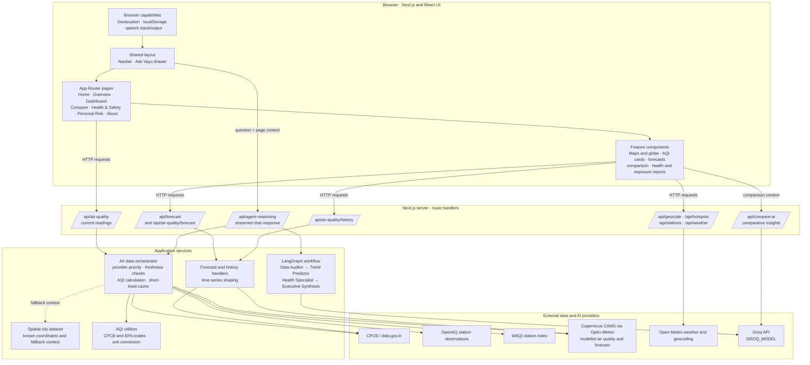

# Vayu Index Architecture

## Request paths

- **Current air:** the UI sends coordinates to `/api/air-quality`. The orchestrator prefers CPCB for Indian locations, then OpenAQ, WAQI, and a CAMS/Open-Meteo model estimate; it uses the spatial dataset as fallback context where available.
- **Forecasts and history:** dedicated route handlers fetch and shape time-series data for forecast, comparison, and reporting views.
- **Ask Vayu:** the shared drawer sends the question and relevant page context to `/api/agent-reasoning`. That route resolves explicitly named places, retrieves air data, and streams a LangGraph synthesis generated with Groq.
- **Personalization:** the browser can provide location and speech capabilities. Theme and selected location preferences are stored locally; this app does not show a central application database in these request paths.
