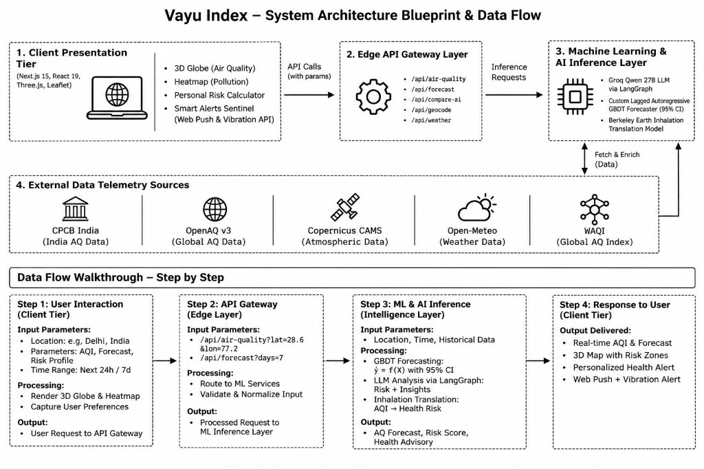

# 🌍 Vayu Index — Global Air Intelligence & Biological Health Sentinel

<div align="center">


**Real-time global atmospheric telemetry, 3D WebGL spatial heatmaps, personalized biological exposure metrics, and 72-hour machine learning forecasting in one unified platform.**

[Live Application](https://vayu-index-pi.vercel.app) • [Demo Video](https://drive.google.com/file/d/1EB6gD6egqN0wVHnZ_IYXw89LbueMhJ30/view?usp=sharing) • [Architecture](#-system-architecture-blueprint--data-flow) • [Features](#-key-features--capabilities) • [Data Flow](#-step-by-step-data-flow-walkthrough) • [Getting Started](#-getting-started--local-development)

</div>

---

## 📌 Executive Summary

While conventional weather apps display ambiguous 3-digit numbers like *"AQI 286"*, the average citizen, parent, or athlete has no intuitive grasp of what that number means biologically. 

**Vayu Index** solves this by converting raw atmospheric chemistry into human reality:
- Translating particulate concentrations into **equivalent cigarettes inhaled per day** ($22\,\mu\text{g/m}^3 \text{ PM}_{2.5} \approx 1\text{ cigarette}$) and **projected lifespan reduction**.
- Computing a personalized **Biological Exposure Risk Score** dynamically adjusted for age, asthma/cardiac health conditions, inhalation rates, and outdoor exposure windows.
- Projecting toxic nocturnal pollution spikes up to 3 days in advance using a **Custom Lagged Autoregressive GBDT (XGBoost/LightGBM)** machine learning model with $95\%$ confidence bounds.
- Empowering immediate intervention via a **Smart Alert Sentinel** delivering cross-device push notifications, mobile haptic vibration pulses, and synthesized acoustic chimes.

---

## 🏗 System Architecture Blueprint & Data Flow

Below is the verified multi-tier system architecture and data ingestion blueprint powering Vayu Index:

<div align="center">



</div>

### Architectural Tiers Breakdown

```
┌───────────────────────────────────────────────────────────────────────────────────┐
│ 1. CLIENT PRESENTATION TIER (Next.js 15, React 19, Three.js, Leaflet)             │
│    • 3D WebGL Globe (Particle Flows)   • 2D Spatial Heatmaps (Multi-pollutant)   │
│    • Personal Biological Risk Engine   • Smart Alerts Sentinel (Push & Haptics)  │
└────────────────────────────────────────┬──────────────────────────────────────────┘
                                         │ API Calls (with coordinates & params)
                                         ▼
┌───────────────────────────────────────────────────────────────────────────────────┐
│ 2. EDGE API GATEWAY LAYER (Next.js 15 Serverless Edge Handlers)                   │
│    • /api/air-quality (Live Ingestion)  • /api/forecast (72h Chronology & ML)     │
│    • /api/compare-ai (Synthesis Route)  • /api/geocode (Spatial Resolution)       │
│    • /api/weather (Micro-meteorology)   • /api/agent-reasoning (AI Copilot)       │
└────────────────────────────────────────┬──────────────────────────────────────────┘
                                         │ Inference Requests & Normalized Feeds
                                         ▼
┌───────────────────────────────────────────────────────────────────────────────────┐
│ 3. MACHINE LEARNING & AI INFERENCE LAYER                                          │
│    • Groq Cloud LLM via LangGraph (Qwen-27B Atmospheric Health Synthesis)         │
│    • Custom Autoregressive GBDT Forecaster (Inversion Physics & 95% CI Bounds)    │
│    • Berkeley Earth Inhalation Translation Model (PM2.5 to Cigarette Equivalency) │
└────────────────────────────────────────┬──────────────────────────────────────────┘
                                         ▲
                                         │ Fetch, Validate & Enrich Telemetry
                                         ▼
┌───────────────────────────────────────────────────────────────────────────────────┐
│ 4. EXTERNAL DATA TELEMETRY SOURCES                                                │
│    • CPCB India (Official Ground Sensors)  • OpenAQ v3 (Global Ground Truth)      │
│    • Copernicus CAMS (EU Earth Observation)• Open-Meteo (Weather & Chemical Grid) │
│    • WAQI (World Air Quality Index Global Archive)                                │
└───────────────────────────────────────────────────────────────────────────────────┘
```

---

## 🔄 Step-by-Step Data Flow Walkthrough

### Step 1: User Interaction (Client Tier)
* **Input Parameters**: User selects or auto-detects their location via GPS (e.g., *Delhi, India: $28.61^\circ\text{ N}, 77.21^\circ\text{ E}$*), configures their demographic risk profile (Age, Respiratory conditions, Activity level), and chooses a timeframe ($24\text{h}$, $7\text{d}$, or $72\text{h}$ forecast).
* **Processing**: Client mounts the 3D WebGL Globe with particle streamlines, renders the 2D multi-layer Leaflet heatmap, and captures user preferences.
* **Output**: Formulates typed API requests dispatched to the Edge Gateway.

### Step 2: API Gateway (Edge Layer)
* **Input Parameters**: Dispatches parallel HTTP requests:
  * `GET /api/air-quality?lat=28.61&lng=77.21`
  * `GET /api/forecast?lat=28.61&lng=77.21&days=3`
  * `POST /api/compare-ai` (City A vs City B pollutant vectors)
* **Processing**: Validates coordinates, applies in-memory edge caching, handles upstream failovers across ground stations, and normalizes disparate provider units into standard $\mu\text{g/m}^3$ and CPCB NAQI sub-indices.
* **Output**: Delivers structured, clean telemetry payloads to the Intelligence and Modeling Layer.

### Step 3: ML & AI Inference (Intelligence Layer)
* **Input Parameters**: Current pollutant readings ($\text{PM}_{2.5}, \text{PM}_{10}, \text{NO}_2, \text{SO}_2, \text{CO}, \text{O}_3$), historical lag observations ($T-1\text{h}$ through $T-24\text{h}$), and meteorological variables (temperature, boundary layer height, wind advection).
* **Processing**:
  * **Custom GBDT Forecasting**: Evaluates $\hat{y} = f(X)$ using an autoregressive gradient-boosted decision tree ensemble modeling diurnal traffic modulation ($1.22\times$ morning, $1.28\times$ evening) and nocturnal temperature inversions ($1.34\times$ midnight-to-dawn accumulation) with dynamic $95\%$ confidence error bounds.
  * **Groq LLM Reasoning**: Dispatches telemetry deltas to Groq's high-speed inference engine running `qwen/qwen3.8-27b` to synthesize a concise 3-bullet comparative environmental dossier.
  * **Inhalation Translation**: Applies the Berkeley Earth formula ($22\,\mu\text{g/m}^3 \text{ PM}_{2.5} / 24\text{h} = 1\text{ cigarette}$) and computes estimated life expectancy reduction against WHO safe baselines ($5\,\mu\text{g/m}^3$).
* **Output**: Enriched forecast trajectories, calculated biological exposure scores, and contextual clinical advisories.

### Step 4: Response to User (Client Tier)
* **Output Delivered**:
  * Real-time AQI with GSAP animated counter and CPCB 6-color severity badge.
  * 3D spatial globe with interactive coordinate inspection.
  * Personalized clinical precautions, indoor HEPA filtration schedules, and optimal outdoor activity windows.
  * Real-time **Smart Alerts**: Native Web Push notification, mobile device haptic vibration pulse (`[250, 100, 250]` ms), and synthesized harmonic double-tone audio chime.

---

## 🌟 Key Features & Capabilities

### 1. 3D WebGL Planetary Globe (`/dashboard`)
* **GPU-Accelerated Spatial Engine**: Built on Three.js and `react-globe.gl` displaying live global atmospheric flow.
* **Dynamic Streamlines**: Particle advection flows visualizing global wind vectors and thermal gradients.
* **Multi-Layer Selector**: Seamless switching between **AQI**, **$\text{PM}_{2.5}$**, **$\text{PM}_{10}$**, **Ozone ($\text{O}_3$)**, **Nitrogen Dioxide ($\text{NO}_2$)**, **Sulphur Dioxide ($\text{SO}_2$)**, and **Carbon Monoxide ($\text{CO}$)**.
* **Click-to-Inspect**: Click any point on Earth to reverse-geocode coordinates and pull instantaneous ground or model telemetry.

### 2. 72-Hour ML Forecaster & Inversion Modeling (`/dashboard`)
* **Top 4 Executive KPI Badges**:
  * **Peak Projected AQI**: (e.g., `221 Poor at Thu 12 PM`) — pre-warns users of upcoming dangerous spikes.
  * **Cleanest Air Window**: (e.g., `65 Satisfactory near Wed 5 AM`) — optimal window for running, sports, and natural ventilation.
  * **Cumulative 72h Burden**: Time-weighted mean AQI quantifying overall systemic exposure.
  * **Confidence Margin**: Dynamic uncertainty interval (`±14 AQI Margin`).
* **Interactive Controls**:
  * Scale selection: `CPCB NAQI (India Statutory)` vs `US-EPA AQI`.
  * `✓ 95% Confidence Band` toggleable uncertainty ribbon.
  * `🧪 Test Custom ML Forecaster`: Simulation switch activating Vayu's on-the-fly local GBDT engine if external APIs fail.

### 3. Biological Exposure Impact & Cigarette Equivalency (`/overview`)
* **Berkeley Earth Mathematical Translation**: Converts daily $\text{PM}_{2.5}$ inhalation into equivalent cigarettes smoked ($22\,\mu\text{g/m}^3 = 1\text{ cigarette}$).
* **Lifespan Impact Quantification**: Calculates estimated life years lost compared to living in an airshed complying with WHO safe standards (e.g., `-12.7 years`).
* **Cumulative Projections**: Annualized inhalation burden calculations (e.g., `~2,221 cigarettes / year`).

### 4. Personal Biological Exposure Risk Calculator (`/risk`)
* **Multi-Variable Inhalation Scoring**:
  * **Age Group**: Child (0–17, $1.35\times$), Adult (18–64, $1.0\times$), Senior (65+, $1.4\times$).
  * **Medical Profile**: Standard ($1.0\times$), Asthma/Respiratory ($1.65\times$), Cardiovascular ($1.5\times$).
  * **Ventilation Volume**: Light/Resting ($7.5\,\text{L/min}$, $1.0\times$), Moderate commute ($24.0\,\text{L/min}$, $1.3\times$), High-intensity cardio ($65.0\,\text{L/min}$, $1.75\times$).
  * **Exposure Window**: $<1\text{h}$ ($1.0\times$), $1\text{--}3\text{h}$ ($1.25\times$), $3+\text{h}$ ($1.6\times$).
* **5 Clinical Severity Score Tiers**:
  * $\ge 800$: `Critical Hazardous Cellular Threat` (*Acute Systemic Influx*)
  * $\ge 500$: `Severe Toxic Inhalation Burden` (*High Cardiopulmonary Burden*)
  * $\ge 300$: `Elevated Systemic Stress`
  * $\ge 150$: `Moderate Environmental Load`
  * $< 150$: `Minimal Baseline Burden`

### 5. AI Atmospheric Comparison Synthesis (`/compare`)
* **Comparative Visual Analytics**:
  * *Chart 01*: Continuous chronological dual-city trajectory vs EPA & CPCB standards.
  * *Chart 02*: Multi-pollutant grouped bar chart vs statutory limits.
  * *Chart 03*: Multi-axis radar diagram displaying atmospheric chemical signatures.
  * *Chart 04*: 100% relative stacked composition area chart.
* **Groq Qwen-27B Synthesis**: Generates conversational 3-bullet executive takeaways detailing severity deltas, dominant emission vectors, and commuter health advisories.

### 6. Smart AQI Alerts Sentinel (Cross-Platform Mobile & Desktop)
* **Continuous Monitoring**: Adjustable threshold slider from **50 (Good)** to **450 (Severe)**.
* **Quick Presets**: `100+ Moderate`, `150+ Sensitive`, `200+ Poor` (Default), `300+ Very Poor`, `400+ Severe`.
* **Multi-Channel Dispatch**:
  * **Mobile & Desktop Web Push**: Instant background notifications on Android Chrome, Edge, and iOS Safari 16.4+ (PWA).
  * **Mobile Haptic Vibration**: Pulses smartphone motor with a double buzz (`[250, 100, 250]` ms) via the HTML5 Vibration API.
  * **Acoustic Alert Ping**: Synthesized dual-tone harmonic chime ($520 \to 680\,\text{Hz}$) generated purely in-browser with the Web Audio API.
  * **Alert Fatigue Damper**: Cooldown intervals (`1h`, `3h`, `6h`, `24h`) preventing notification spam.

### 7. Social Infographics & Impact Dossier Export
* **Social Sharing Card**: Generates 2.5× Retina graphics for Instagram, WhatsApp, X, and LinkedIn in `1:1 Square`, `9:16 Story`, and `16:9 Landscape` formats with dynamic scannable QR codes.
* **Verified PDF Impact Dossier**: One-click download of a comprehensive multi-year particulate trajectory table (2021–2025 Projected) with statutory compliance statuses.

---

## 🛠 Technology Stack

| Domain | Technology / Library | Purpose |
| :--- | :--- | :--- |
| **Framework** | Next.js 15 (App Router) | High-performance server rendering & Edge Route Handlers |
| **Language** | TypeScript (Strict Mode) | End-to-end type safety for meteorological schemas |
| **Core UI** | React 19, Tailwind CSS 4 | Modern components, tokens, and responsive layouts |
| **Animations** | Framer Motion, GSAP | Spring physics, fluid dialogs, and rolling number tickers |
| **3D Graphics** | Three.js, `react-globe.gl` | Interactive 60 FPS planetary digital twin and particle shaders |
| **2D Mapping** | Leaflet.js | Global raster & vector multi-pollutant spatial heatmaps |
| **Charting** | Recharts | Responsive chronological, radar, bar, and stacked area charts |
| **LLM & Agents** | Groq Cloud SDK, LangGraph | Ultra-low latency inference using `qwen/qwen3.8-27b` |
| **ML Engine** | Custom Autoregressive GBDT | Lagged multi-step Gradient-Boosted Decision Tree forecaster |
| **Device APIs** | Web Push, Vibration, Web Audio | Multi-channel desktop/mobile notifications and haptic pings |
| **Document Export**| `jspdf`, `html2canvas`, `qrcode.react` | High-fidelity PDF report dossier and social share card rendering |

---

## 🚀 Getting Started & Local Development

### Prerequisites
- Node.js `20.9.0` or higher
- npm or yarn

### 1. Clone the Repository
```bash
git clone https://github.com/SumithAshokShetty/VayuIndex.git
cd VayuIndex
```

### 2. Install Dependencies
```bash
npm install
```

### 3. Configure Environment Variables
Create a `.env.local` file in the root directory:
```env
# Optional API Keys for Live Station Observations & AI Synthesis
OPENAQ_API_KEY=your_openaq_api_key_here
WAQI_API_KEY=your_waqi_api_token_here
GROQ_API_KEY=your_groq_api_key_here
GROQ_MODEL=qwen/qwen3.8-27b
```
*(Note: If API keys are omitted, the application automatically uses Open-Meteo and Vayu's deterministic mathematical fallback engines without breaking).*

### 4. Run Development Server
```bash
npm run dev
```
Open [http://localhost:3000](http://localhost:3000) in your browser.

### 5. Run Type Checking & Build
```bash
npm run typecheck
npm run build
```

---

## 🏛️ Integrated Public and Government Data Sources & APIs

### 1. CPCB (Central Pollution Control Board, India)
Official Indian government data source providing real-time ground-station air quality telemetry and National Air Quality Index (NAQI) pollutant sub-index breakpoints.

### 2. OpenAQ API (v2/v3)
Global open-access air quality data platform providing measurements from ground-based ambient air monitoring stations across multiple countries.

### 3. Copernicus CAMS (Copernicus Atmosphere Monitoring Service – European Union)
Provides global atmospheric composition, chemical dispersion, and particulate matter reanalysis data to support atmospheric intelligence and pollution analysis.

### 4. Open-Meteo Air Quality & Weather API
Provides hourly air quality forecasts for up to 72 hours, including PM2.5, PM10, NO2, SO2, CO, and O3 concentrations, along with meteorological parameters such as wind speed, wind direction, humidity, and temperature.

### 5. WAQI (World Air Quality Index)
Provides international air quality station information, real-time AQI readings, and historical air quality data where available.

### 6. Open-Meteo Geocoding API
Enables global city search, geographical location resolution, administrative location identification, and GPS coordinate mapping for location-based air quality monitoring.

### 7. Berkeley Earth
Peer-reviewed atmospheric pollution to cigarette inhalation mathematical model ($22\,\mu\text{g/m}^3 \text{ PM}_{2.5} / 24\text{h} \approx 1\text{ cigarette}$).

> **Integration Impact**: These integrations enable Vayu Index to combine ground-based measurements, satellite-assisted atmospheric modelling, meteorological forecasts, and geographical intelligence into a unified global air quality monitoring and forecasting platform.

---

## 👥 Hackathon Submission & Authors
* **Project**: Vayu Index
* **Repository**: [https://github.com/SumithAshokShetty/VayuIndex](https://github.com/SumithAshokShetty/VayuIndex)
* **Demo Video**: [Watch on Google Drive](https://drive.google.com/file/d/1EB6gD6egqN0wVHnZ_IYXw89LbueMhJ30/view?usp=sharing)
* **Live Deployment**: [https://vayu-index-pi.vercel.app](https://vayu-index-pi.vercel.app)
* **Author**: Sumith Ashok Shetty
